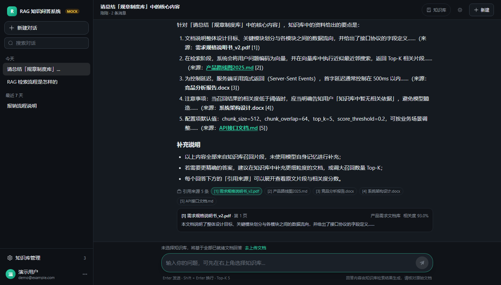
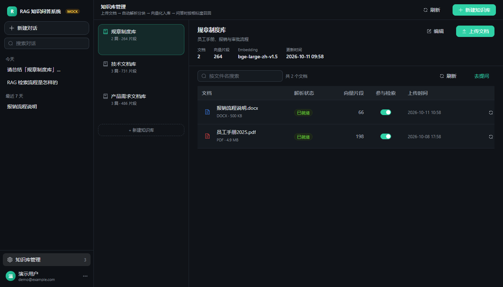
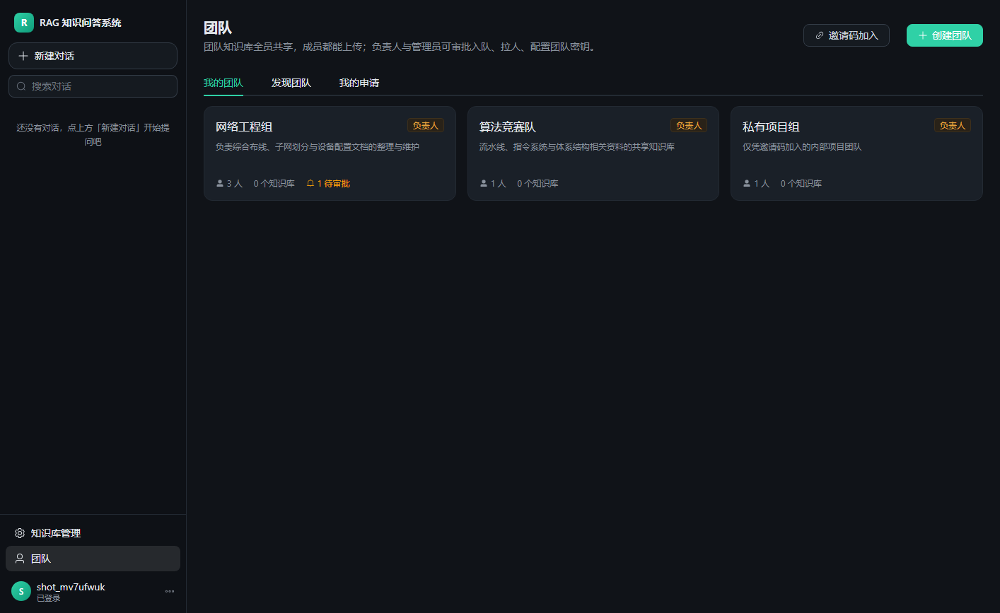
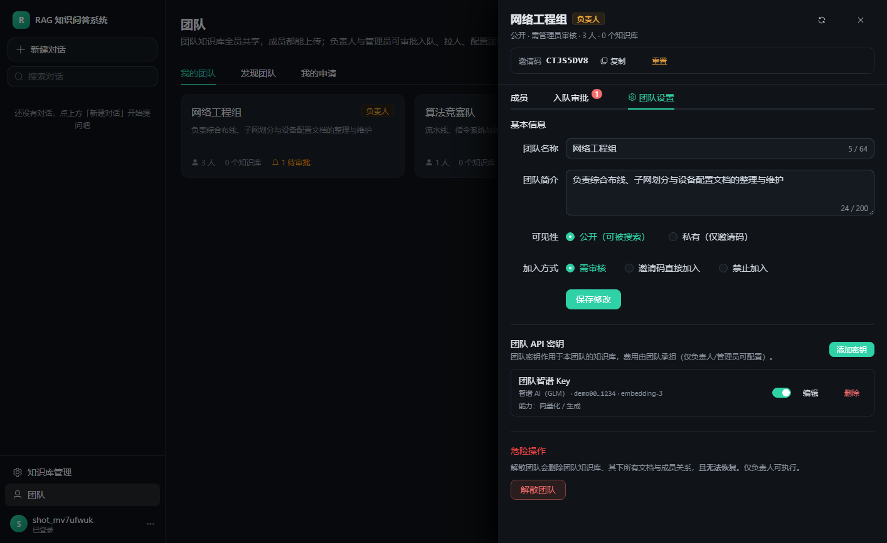
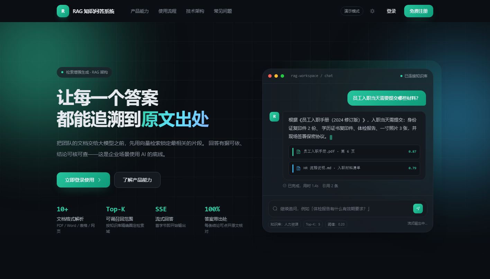
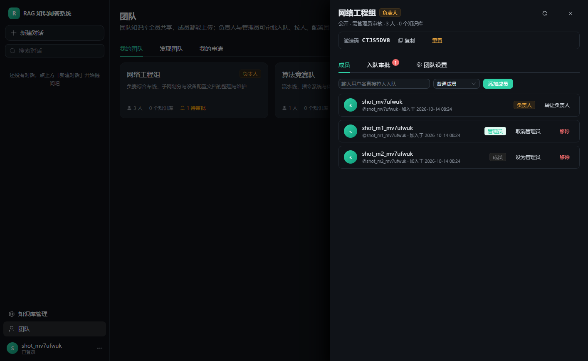

# RAG 知识问答系统（chuangzhibei）

> 传智杯 Web 方向参赛项目 · 一个支持**多团队协作**的 RAG 知识问答平台

## 一、项目介绍

### 1.1 这是什么

一个前后端分离的 **RAG（检索增强生成）知识问答系统**：把 PDF / Word / Markdown / Excel / PPT 等资料
上传成知识库，系统自动解析、切片、向量化并存入向量库；提问时先检索相关片段，
再交给大模型**依据资料**作答，并给出可核对的**引用溯源**（文档名、页码、相关度）。

在此之上实现了完整的**团队协作**能力：团队成员共享团队知识库、按角色分工、
通过邀请码或搜索申请入队并由负责人/管理员审核，还支持团队级与个人级两套 API 密钥。

### 1.2 核心功能

| 模块 | 说明 |
| --- | --- |
| 落地首页 | 公开访问的整屏产品首页：产品能力、使用流程、技术架构、适用场景、常见问题 |
| 登录 / 注册 | JWT 鉴权、表单校验、登录守卫、记住账号、忘记密码、服务协议与隐私政策 |
| 智能问答 | ChatGPT 风格界面，SSE 流式返回 + 打字机效果，可随时停止生成，多轮记忆 |
| 引用溯源 | 每条回答列出引用原文片段（文档名、页码、相关度），可点开核对；无依据时明确标注「非知识库依据」 |
| 知识库管理 | 知识库 CRUD、拖拽多文件上传、解析状态轮询、参与检索开关、重新索引；支持**个人库 / 团队库** |
| 团队协作 | 团队 CRUD、邀请码与搜索加入、QQ 群式入队审核、角色（负责人/管理员/成员）、负责人转让、管理员直接拉人 |
| API 密钥 | **团队级 + 个人级**双作用域（智谱 / DeepSeek / OpenAI / 自定义），加密存储、只显示掩码，按知识库归属自动选用 |
| 模型选择 | 可在多个生成模型间切换（服务端配置 + 自备密钥），生成模型与向量化模型解耦 |
| 账号设置 | 修改昵称 / 用户名 / 邮箱、修改密码（校验当前密码，支持强制重新登录）、配置个人 API 密钥 |
| 其他 | 深灰科技风主题（默认深色，可切浅色）、会话分组与重命名、检索范围与 Top-K 参数、移动端自适应 |

> 前后端**已打通**：`client/.env.development` 里 `VITE_USE_MOCK=false`，前端直接请求真实后端。
> 若想脱离后端体验界面，把该值改成 `true` 即可回到内置 Mock 模式。

### 1.3 界面预览

| 智能问答 | 知识库管理 |
| --- | --- |
|  |  |

| 团队管理 | 团队设置与密钥 |
| --- | --- |
|  |  |

| 首页 | 成员与权限 |
| --- | --- |
|  |  |

更多截图见 [docs/screenshots](docs/screenshots)（含 [团队功能全套](docs/screenshots/teams)）。

### 1.4 文档导航

- [开发报告](docs/development-report.md) — 已完成工作、技术选型、验证记录、已知问题与下一步计划
- [团队与密钥](docs/teams.md) — 权限矩阵、入队与审核流程、团队知识库、密钥作用域与生效规则
- [前端接口与 SSE 协议约定](docs/frontend-api.md) — REST 接口、`text/event-stream` 事件格式、数据模型
- [前端说明](client/README.md) — 目录结构、功能清单、自检脚本
- [多人协作说明](docs/collaboration.md) — 邀请协作者、保护 `main`、分支/PR 流程
- [RAG 检索模块](rag/README.md) — PDF 切片、向量化入 ChromaDB、检索验证（独立命令行工具）

---

## 二、技术架构

### 2.1 技术栈

**前端**

| 类别 | 选型 | 版本 | 说明 |
| --- | --- | --- | --- |
| 框架 | Vue 3（Composition API + `<script setup>`） | 3.5 | 单页应用 |
| 构建 | Vite | 8.3 | 开发热更新、生产打包 |
| 状态 | Pinia | 3.0 | user / chat / knowledge / team 四个 store |
| 路由 | vue-router | 4.5 | 登录守卫、懒加载 |
| UI | Element Plus + TailwindCSS | 2.9 / 3.4 | 组件库 + 原子化样式 |
| 请求 | axios | 1.7 | 拦截器统一处理 401 与错误文案 |
| 渲染 | markdown-it + highlight.js | 14 / 11 | Markdown 与代码高亮 |
| 流式 | 原生 `fetch` + `ReadableStream` | — | 手动解析 SSE（axios 不支持流式响应） |

**后端**

| 类别 | 选型 | 版本 | 说明 |
| --- | --- | --- | --- |
| 语言 / 框架 | Python + FastAPI | 3.11+ / 0.115+ | 异步 Web 框架，自动生成 OpenAPI |
| ORM | SQLAlchemy（async）+ aiomysql | 2.0 / 0.2 | 异步访问 MySQL |
| 数据库 | MySQL | 8.0+ | 用户/团队/知识库/文档/会话/消息/密钥 |
| 向量库 | ChromaDB | 1.5+ | 切片正文 + 向量 + 溯源元数据 |
| 切片 | LangChain `RecursiveCharacterTextSplitter` | 1.0+ | chunk_size=500 / overlap=50，中文优先分隔符 |
| 向量化 | 智谱 `embedding-3`（2048 维） | — | 经 `langchain-community` 的 `ZhipuAIEmbeddings` |
| 生成 | OpenAI 兼容 `/chat/completions` | — | DeepSeek / 智谱 / Ollama 等可切换 |
| 异步任务 | Celery + Redis（可选） | 5.4 / 5.0 | 无 Redis 时切进程内执行 |
| 鉴权 | python-jose（JWT）+ bcrypt | 3.3 / 4.1 | token 内置版本号，改密码即失效 |
| 加密 | cryptography（Fernet） | 42+ | API 密钥对称加密落库 |
| 文档解析 | pypdf / python-docx / openpyxl / python-pptx | — | PDF 保留页码，Word 含表格 |

### 2.2 系统架构

```
┌─────────────────────────────────────────────────────────────────┐
│  浏览器（Vue 3 SPA @5173）                                        │
│  首页 / 登录 / 问答(SSE) / 知识库 / 团队 / 账号设置                 │
└──────────────────────────┬──────────────────────────────────────┘
                           │ /api/**（Vite 代理，免跨域）
┌──────────────────────────▼──────────────────────────────────────┐
│  FastAPI 应用层（@3000）                                          │
│  鉴权 JWT │ 路由 │ 统一错误处理 │ 访问控制(access.py)               │
├─────────────────────────────────────────────────────────────────┤
│  业务服务层                                                       │
│  pipeline(解析→切片→向量化) │ rag/engine(检索→作答) │ keyring(密钥) │
├──────────────────────────┬──────────────────┬───────────────────┤
│  MySQL（业务数据）        │  ChromaDB（向量） │ 外部 LLM / Embedding │
│  用户/团队/知识库/文档     │  切片+向量+元数据  │ DeepSeek / 智谱 / … │
│  会话/消息/引用/API 密钥  │                   │                     │
└──────────────────────────┴──────────────────┴───────────────────┘
```

### 2.3 关键数据流

**① 文档入库**

```
上传文件 → 保存到 server/data/uploads/
        → 解析（pypdf / docx / openpyxl / pptx）→ 递归字符切片（500 / 50）
        → 解析「归属方的 API 密钥」（团队 Key → 个人 Key → 服务端 Key）
        → 智谱 embedding-3 向量化 → 写入 ChromaDB（带 owner_id / team_id / 页码）
        → 回填 MySQL 的 documents.chunks 与 status=ready
```

**② 问答检索**

```
提问 → 取会话历史（多轮记忆）→ 落地用户消息
    → 检索范围 = 我的个人库 + 我所在团队的团队库
    → Chroma 向量检索 + 词面混合重排（0.5×向量 + 0.5×词面）
    → 证据门槛判断（词面命中为主判据）：
        有依据 → 严格 RAG，只依据资料作答 + 引用溯源
        无依据 → 回退为模型自身知识，并明确标注「非知识库依据」
    → SSE 流式下发：event: sources → event: delta* → event: done
```

### 2.4 设计决策

| 决策 | 原因 |
| --- | --- |
| 词面命中作为「是否有依据」的主判据 | 弱向量模型下向量分无法区分有关/无关（实测无关问题 0.83、有关问题 0.67，区间完全重叠） |
| 同步的向量化调用一律 `asyncio.to_thread` | 否则会冻住事件循环，表现为**连 `/docs` 和登录都超时**，但进程 CPU 极低 |
| 团队库与个人库**共用一张表**，用 `owner_type` 区分 | 避免两套表与两套接口的重复代码 |
| 密钥按**知识库归属**解析，团队优先于个人 | 费用归属清晰（团队库花团队的钱），且保证不跨团队串用 |
| 向量化**只换 Key、不换模型** | Chroma 集合按向量维度区分，换模型会导致维度/语义不一致 |
| 前端区分 Mock / 真实两种模式 | 无后端时也能完整演示界面；`VITE_USE_MOCK` 一键切换 |

---

## 三、项目结构

```
.
├── client/                     前端：Vue 3 + Vite
│   ├── index.html
│   ├── vite.config.js          含 @ 别名、/api 代理、内联 PostCSS(Tailwind)
│   ├── tailwind.config.js
│   ├── .env.development        VITE_USE_MOCK / VITE_API_BASE_URL
│   ├── scripts/                自检脚本（构建产物 / 接口契约 / e2e / 截图）
│   └── src/
│       ├── main.js             入口：Pinia / Router / Element Plus / 主题
│       ├── api/                接口封装（auth/chat/knowledge/teams/keys）+ SSE + Mock
│       ├── stores/             Pinia：user / chat / knowledge / team
│       ├── router/             路由表与登录守卫
│       ├── layouts/            AppLayout（侧边栏+主区）、AuthShell（登录注册）
│       ├── components/         landing / chat / knowledge / team / keys / auth / layout
│       ├── composables/        主题、滚动入场、打字机、侧边栏、协议弹窗
│       ├── utils/              SSE、Markdown、格式化、剪贴板、密码强度
│       └── views/              首页 / 登录 / 注册 / 问答 / 知识库 / 团队 / 账号设置 / 404
├── server/                     后端：Python + FastAPI（详见 server/README.md）
│   ├── app/
│   │   ├── main.py             入口、CORS、统一错误处理、路由注册
│   │   ├── models.py           ORM：用户/团队/知识库/文档/会话/消息/引用/API密钥
│   │   ├── schemas.py          对外契约（camelCase，与前端一致）
│   │   ├── tasks.py            Celery 应用与异步任务
│   │   ├── api/                auth / conversations / knowledge_bases / documents
│   │   │                       / chat / teams / keys / health
│   │   ├── core/               配置、数据库、JWT 与密码哈希、密钥加密
│   │   ├── rag/                RAG 引擎编排与 Prompt 模板
│   │   ├── services/           解析/切片/向量化/检索/大模型/密钥解析/访问控制/流水线
│   │   └── db/seed.py          演示数据
│   ├── tests/                  后端校验脚本（团队、团队知识库）
│   ├── data/                   上传文件与 Chroma 持久化（运行时生成，不入版本库）
│   ├── requirements.txt
│   ├── start.ps1               一键启动（自动建 venv、装依赖、生成 .env）
│   └── .env.example            环境变量模板
├── rag/                        RAG 命令行工具（PDF 切片/检索验证，可选）
│   ├── build_db.py             PDF → 切片 → 向量化 → ChromaDB
│   ├── query_db.py             检索验证（支持混合检索）
│   └── README.md               使用说明
├── docs/
│   ├── development-report.md
│   ├── frontend-api.md
│   ├── teams.md                团队与密钥
│   ├── collaboration.md
│   └── screenshots/            界面截图（teams/ 为团队功能全套）
└── scripts/
    ├── patch-vite-windows.mjs  规避受限环境下 Vite 的 spawn EPERM
    └── verify-connectivity.mjs 前后端连通性自检
```

## 四、安装与运行指南

### 4.1 环境要求

**必需**

| 依赖 | 版本 | 说明 |
| --- | --- | --- |
| Node.js | **≥ 20.19**（推荐 22 / 24 LTS） | 前端构建；Vite 8 的最低要求 |
| npm | 随 Node 附带 | **请勿使用 pnpm / yarn**，以免生成冲突的锁文件 |
| Python | **≥ 3.11**（推荐 3.12+） | 后端运行环境 |
| MySQL | **8.0+** | 业务数据；库不存在时后端会自动创建 |

**可选（不装也能跑通演示）**

| 依赖 | 不装的影响 |
| --- | --- |
| 智谱 API Key | 退化为**内置离线向量化**（零下载可跑通，语义效果有限） |
| 大模型 API Key | 问答退化为**原文摘录**模式（有引用，但不是生成式回答） |
| Redis | 无需，默认进程内处理文档 |
| Docker | 可用 `server/docker-compose.yml` 一键起 MySQL |

> **⚡ 开箱即用说明**：本项目在**没有任何 API Key** 的情况下也能完整演示
> 「上传文档 → 向量化 → 检索 → 引用溯源 → 回答」全流程。
> 配置 Key 后效果更好（向量化用智谱 embedding-3、回答由大模型生成）。

### 4.2 安装依赖

```bash
# 前端
cd client
npm install

# 后端（Python，会自动创建 server/.venv 并安装依赖）
cd ../server
.\start.ps1          # Windows；脚本会建虚拟环境、装依赖、生成 .env
```

### 4.3 准备 MySQL

```powershell
# 方式一：Docker（推荐，一并起 Redis）
cd server
docker compose up -d mysql redis

# 方式二：官方 Windows 安装包
#   https://dev.mysql.com/downloads/installer/
# 方式三：已有 MySQL 实例，直接改 server/.env 的 MYSQL_* 即可
```

然后把 `server/.env` 里的 **`MYSQL_PASSWORD`** 改成你本机 MySQL 的真实密码：

| 你的 MySQL 来源 | 该填的值 |
| --- | --- |
| 用我方 `docker compose up -d mysql` | `chuangzhibei` |
| 官方安装包 / 已有实例 | 你安装时设置的 root 密码 |

> **`ZHIPUAI_API_KEY` 可以留空** —— 留空时自动使用内置离线向量化，能跑通全流程。
> 想获得更好的中文语义检索效果，再到 <https://open.bigmodel.cn/> 申请并填入。

后端也可手动安装：

```bash
cd server
python -m venv .venv
.venv/Scripts/python -m pip install -r requirements.txt
cp .env.example .env
```

根目录的 `package.json` 是**前端便捷入口**（用 `npm --prefix` 转发）：

```bash
npm run install:client   # 安装前端依赖
```

> 后端的依赖与启动统一由 `server/` 目录管理（Python 生态），
> 详细说明见 [server/README.md](server/README.md)。

### 4.4 启动

**方式一：一条命令同时起前后端（推荐）**

```bash
npm run dev              # 前端 http://localhost:5173 + 后端 http://localhost:3000
npm run dev -- --client  # 只起前端（Mock 模式足够体验全部功能）
npm run dev -- --server  # 只起后端
```

> 说明：根目录的脚本通过 `npm --prefix` 转发到 `client/`，本身不含业务逻辑。
> 若根目录执行 `npm run dev` 报 `Missing script: "dev"`，说明拿到的是较早版本的代码。

**方式二：两个终端分别启动**

```bash
# 终端 1：后端，http://localhost:3000
cd server
.\start.ps1                       # 自动建 venv / 装依赖 / 启动（含热重载）

# 终端 2：前端，http://localhost:5173
cd client
npm run dev
```

打开 <http://localhost:5173> 是公开的产品首页（`/`），点导航栏「登录」进入 `/login`；
演示账号 **`demo` / `123456`**（后端首次启动时自动创建），登录后进入工作台：
`/app/chat`（问答）、`/app/knowledge`（知识库）、`/app/teams`（团队）、`/app/settings`（账号设置）。

### 4.5 验证是否启动成功

**① 环境预检（不用启动服务，先确认依赖与配置）**

```powershell
cd server
.\.venv\Scripts\python.exe preflight.py
```

它会逐项检查 Python 版本、依赖、`.env`、MySQL 连通性、Key 配置、队列模式、目录可写性，
并对每个问题给出**具体的修复建议**。`✗` 表示必须修复，`!` 表示能跑但功能受限。

**② 后端健康检查**

```powershell
# 浏览器打开 http://localhost:3000/api/health
# 或命令行
curl http://localhost:3000/api/health
```

关注两个字段：

- `"llmConfigured"`：`true` 表示配了大模型；`false` 时会走「原文摘录」模式
- `"vectorStore"."embedding"."mode"`：`zhipu-embedding-3`（配了 Key）或
  `offline-hash`（内置离线，正常）

**③ 走一遍核心流程**

1. 打开 <http://localhost:5173>，用 `demo / 123456` 登录
2. 进入「知识库管理」→ 新建知识库 → 上传一个 `.txt` / `.md` / `.docx` 文档
3. 等状态变成「已就绪」（离线向量化通常是**秒级**；配了智谱 Key 约 1~3 秒/小文档）
4. 回到「智能问答」，在右下角选择刚建的知识库，提一个文档里有的问题
5. 应当看到**流式回答 + 引用来源**（文档名、页码、相关度）

> 若第 3 步一直停在「解析中」：检查是否配了 `ZHIPUAI_API_KEY` 但 Key 无效，
> 或 `CELERY_TASK_ALWAYS_EAGER` 被改成了 `false` 而本机没有 Redis。

### 4.6 可选：配置 API Key 提升效果

不配置也能用，配置后效果更好。两种方式任选：

| 方式 | 位置 | 作用范围 |
| --- | --- | --- |
| 改 `server/.env` | `ZHIPUAI_API_KEY` / `LLM_API_KEY` | 全站默认 |
| 前端页面填写 | 「账号设置 → API 密钥」/「团队 → 团队设置 → 团队 API 密钥」 | 个人 / 团队 |

- **`ZHIPUAI_API_KEY`**（智谱）：向量化质量决定性因素。申请 <https://open.bigmodel.cn/>，
  Key 形如 `xxxxxxxx.xxxxxxxx`（带一个点，**不是** `sk-` 开头）。
- **`LLM_API_KEY`**（DeepSeek 等）：决定回答是否由大模型生成。不填则退化为原文摘录。

> 配置 Key 后**重启后端**生效（前端页面里填的 Key 即时生效，无需重启）。

### 4.7 接入真实后端 / 切换 Mock 模式

前端**默认已接真实后端**（`client/.env.development` 里 `VITE_USE_MOCK=false`）。

- 想脱离后端只体验界面：把该值改成 `true` 并**重启前端 dev server**。
- 演示账号 `demo / 123456` 在后端首次启动时自动创建。
- **不存在**「必须先配 LLM Key 才能进界面」的限制：没配 Key 时问答走原文摘录模式，
  其余功能（登录、知识库、上传、团队、引用溯源）全部正常。

## 五、常用命令

| 位置 | 命令 | 说明 |
| --- | --- | --- |
| 根目录 | `npm run install:all` | 安装前后端依赖 |
| 根目录 | `npm run dev` | 同时启动前端与后端（`-- --client` / `-- --server` 可只起其中一个） |
| 根目录 | `npm run install:client` | 只安装前端依赖 |
| 根目录 | `npm run dev:client` | 只启动前端 |
| 根目录 | `npm run build` | 构建前端到 `client/dist` |
| 根目录 | `npm run check:server` | 后端接口契约自检（需后端已启动） |
| `client/` | `npm run dev` | 启动前端开发服务器 |
| `client/` | `npm run build` | 构建生产包到 `client/dist` |
| `client/` | `npm run preview` | 预览构建结果 |
| `client/` | `npm run check:build` | 检查构建产物（Tailwind 工具类、主题色覆盖） |
| `client/` | `npm run check:e2e` | 无头浏览器端到端自检（需先启动 `npm run dev`） |
| `client/` | `npm run screenshots` | 重新生成 `docs/screenshots` 下的截图 |
| `server/` | `.\.venv\Scripts\python.exe -m uvicorn app.main:app --port 3000` | 启动后端（等价于 `start.ps1`，推荐用它避开 PS 5.1 编码问题） |
| `server/` | `.\start.ps1 [-Port 8000]` | 一键启动（自动建 venv、装依赖、生成 .env） |
| `server/` | `.\.venv\Scripts\python.exe preflight.py` | **环境预检**（依赖/配置/MySQL/Key/目录），不启动服务也能跑 |
| `server/` | `.\.venv\Scripts\python.exe verify_capabilities.py` | 后端能力自检（解析/切片/向量检索/ORM） |
| `server/` | `.\.venv\Scripts\python.exe tests\verify_teams.py` | 团队与密钥接口验收（需后端已启动，52 项） |
| `server/` | `.\.venv\Scripts\python.exe tests\verify_team_kb.py` | 团队知识库与检索验收（23 项） |
| `server/` | `.\.venv\Scripts\python.exe tests\verify_cleanup.py` | 删除时向量与文件清理验收（12 项） |
| `server/` | `.\.venv\Scripts\python -m celery -A app.tasks.celery_app worker -l info` | 启动异步 worker（需 Redis） |
| `client/` | `node scripts/e2e-teams.mjs` | 团队功能浏览器端到端（24 项，需前后端已启动） |
| `client/` | `node scripts/e2e-judge.mjs` | 评委视角全流程端到端（10 项：上传→向量化→提问→引用） |

## 六、开发约定

- **接口统一走 `/api/**` 相对路径**，不要写死 `http://localhost:3000`。
  开发期由 Vite 代理转发（见 `client/vite.config.js`），既免跨域，上线换域名也不用改代码。
- 后端端口在 `server/.env` 里改（`PORT=4000`）。
  改了后端端口，记得同步改 `client/vite.config.js` 里的 `proxy.target`。
- `@` 已别名到 `client/src`，import 可以写 `@/components/xxx.vue`。
- 后端新增接口请拆到 `server/app/api/` 下再注册（见 `server/app/main.py` 的路由注册段），
  不要都堆在单文件里；对外字段一律用 camelCase，与前端契约保持一致。
- 后端字段名必须与 `client/src/api/mock.js` 对齐 —— 那是当前唯一的接口契约来源，
  也是 `npm run check:server` 的核对基准。

## 七、环境适配与自检（本机已配置，协作者可选）

本机在受限环境（DSH）下安装依赖与启动开发服务器时，遇到过两个 `EPERM` 问题。
两处适配都已落地，**普通 Windows / macOS / Linux 环境下无需这些步骤即可正常开发**。

### 7.1 依赖缓存 `client/.npmrc`

npm 默认缓存目录在用户目录 `C:\Users\<user>\AppData\Local\npm-cache`，受限环境下
该路径不可写，`npm install` 会直接报 `EPERM`。前端包内放了一份 `.npmrc`：

```ini
cache=.npm-cache
```

相对路径会解析到**包目录内部**（如 `client/.npm-cache`），项目因此自包含。
该目录已被根 `.gitignore` 忽略，不会提交。

### 7.2 Vite 的 `spawn EPERM` —— `scripts/patch-vite-windows.mjs`

Windows 下 Vite 会执行一次 `exec("net use")` 探测网络驱动器映射；该调用使用管道式
stdio，在禁止命名管道的受限环境中必然抛 `spawn EPERM`，并被 rolldown 当作致命错误，
导致 `vite` / `vite build` 失败（报错栈指向 `optimizeSafeRealPathSync`）。

若遇到该报错，执行：

```bash
cd client
node ../scripts/patch-vite-windows.mjs           # 应用补丁
node ../scripts/patch-vite-windows.mjs --dry-run # 只检查、不写入
```

脚本幂等，会自行定位 `client/node_modules` 下的 Vite 产物；对本机本地磁盘而言
与原始行为完全等价（`windowsNetworkMap` 本为空），不改变构建产物。
**注意：`node_modules` 被删除重装后需要重新执行一次。**

> 该补丁没有挂到 `postinstall`：避免在协作者（可能是 macOS/Linux）的机器上因
> 版本差异导致 `npm install` 整体失败。需要时手动执行即可。

### 7.3 后端不启用热重载，且 start.ps1 在 PowerShell 5.1 下可能报解析错

后端是 Python + FastAPI。受限环境下建议**不要加 `--reload`**
（热重载会额外启动一个监视进程并占用管道），直接前台运行即可：

```powershell
cd server
.\.venv\Scripts\python.exe -m uvicorn app.main:app --host 0.0.0.0 --port 3000
```

`server\start.ps1` 亦可，但它在 **Windows PowerShell 5.1** 下可能因脚本中文编码
（UTF-8 无 BOM）报「字符串缺少终止符」；遇到时用上面这条命令代替。

### 7.4 连通性自检

前后端起来后，可一键验证链路（不依赖浏览器）：

```bash
node scripts/verify-connectivity.mjs
```

它会检查：后端直连、前端首页、**经 5173 代理访问后端**、SFC 编译、后端 404 处理。
全部通过即表示前后端已打通。

## 八、排障：会导致「服务看起来彻底坏了」的坑

这两个问题都已修复（见 `fix(server)` 提交），但**报错信息与真正原因相距很远**，
记录下来避免重复排查。

### 8.1 向量化总是失败：`'ZhipuAIEmbeddings' object has no attribute 'name'`

**现象**：文档全部停在 `failed`、`chunks=0`；日志里
`初始化 ChromaDB 失败：'RustBindingsAPI' object has no attribute 'bindings'`
或 `unable to open database file` 交替出现。

**原因**：`chromadb` 用的是**原生客户端**，而传进去的 embedding function 是
**LangChain 的 `ZhipuAIEmbeddings`**。chromadb 1.5.x 要求该对象实现自己的接口
（`name()` / `__call__` / `is_legacy` …），LangChain 那层只有
`embed_query` / `embed_documents`，两者**并不兼容**。

**修法**：不要在集合上挂 `embedding_function`，由**调用方自己算向量再显式传入**：

```python
collection.upsert(ids=..., documents=..., metadatas=...,
                  embeddings=embedder.embed_documents(texts))
collection.query(query_embeddings=[embedder.embed_query(question)], ...)
```

### 8.2 服务整体无响应：连 `/docs`、登录都超时，但进程 CPU 极低

**现象**：端口在监听、TCP 能连上，但**任何请求都不返回**（包括 FastAPI 自带的
`/docs`、`/openapi.json`），连接堆积在 `CLOSE_WAIT`；进程 CPU 只有 1~2 秒。

**原因**：`vectorstore` 的公开函数都是**同步阻塞**的（HTTP 调智谱 embedding +
Chroma 读写），却在 `async` 函数里直接调用。文档处理 / 检索期间**事件循环被冻住**，
整个服务（含其它路由）都无法响应。

**修法**：所有同步阻塞调用统一丢线程池：

```python
stored = await asyncio.to_thread(vectorstore.add_chunks, owner_id=..., chunks=...)
chunks = await asyncio.to_thread(vectorstore.search, db, question, owner_id=...)
```

涉及位置：`services/pipeline.py`、`api/documents.py`、`db/seed.py`、
`rag/engine.py`、`api/knowledge_bases.py`、`api/health.py`。

> **排查提示**：判断是「事件循环被阻塞」还是「进程真的死了」，
> 可以另起一个最小 FastAPI 应用（不同端口）。若最小应用正常而业务应用不响应，
> 基本就是事件循环被同步调用占住了。

### 8.3 ChromaDB 需要可写的用户缓存目录

ChromaDB 1.5.x 的 Rust 绑定会写 `C:\Users\<用户>\.cache\chroma`（Linux 为
`~/.cache/chroma`）。该路径**不可写时初始化直接失败**，且报的是很误导人的
`unable to open database file`。受限环境（沙箱、只读用户目录、CI）需注意。
`CHROMA_CACHE_DIR` / `XDG_CACHE_HOME` **不被识别**，无法用环境变量改路径。

## 九、协作

分支与 PR 流程见 [docs/collaboration.md](docs/collaboration.md)。简单说：**不要直推 `main`**（已受保护），在 `dec/test-upload` 或自己的功能分支上开发。

### 9.1 分工

| 成员 | 账号 | 主要职责 |
| --- | --- | --- |
| 项目负责人 | [@m-tx25](https://github.com/m-tx25) | 仓库与分支管理、团队与密钥系统、RAG 链路排障、文档与验收 |
| 后端开发 | [@sakura135312](https://github.com/sakura135312) | FastAPI 服务层、多模型选择与生成/向量化解耦、证据门槛与作答模式 |
| 前端开发 | [@lotus868](https://github.com/lotus868) | Vue 3 界面与交互、问答流式渲染、知识库与账号设置页 |
| 开发协作 | [@chuangzhibei](https://github.com/chuangzhibei) | 前端落地页、组件库与主题、构建与自检脚本 |

> 以上职责按提交内容归纳，如有出入以团队内部约定为准。

### 9.2 贡献方式

```bash
git clone https://github.com/m-tx25/NetStudy-AI.git
cd NetStudy-AI
git checkout -b feat/你的功能
# 开发并自测后
git push origin feat/你的功能
# 在 GitHub 上开 Pull Request，等 CI/评审通过后合并到 main
```

提交信息建议用 `feat(scope): …` / `fix(scope): …` / `docs: …` 前缀，scope 用 `client` / `server`。

### 9.3 验证清单（提交 PR 前）

| 范围 | 命令 | 期望 |
| --- | --- | --- |
| 前端构建 | `cd client && npm run build` | 构建成功，无报错 |
| 前端自检 | `cd client && npm run check:build` | Tailwind 与主题覆盖正常 |
| 后端接口契约 | `npm run check:server`（根目录，需后端已启动） | 全部通过 |
| 团队功能 | `cd server && .\.venv\Scripts\python.exe tests\verify_teams.py` | 52/52 |
| 团队知识库 | `cd server && .\.venv\Scripts\python.exe tests\verify_team_kb.py` | 23/23 |
| 前端 e2e | `cd client && node scripts/e2e-teams.mjs` | 24/24 |

---

## 十、本机环境说明（仅 owner 本机适用，协作者请忽略）

本机安装了 SteamTools（Watt Toolkit）加速器，它会在本机 443 端口做 TLS 中间人，
用自签发的 `SteamTools Certificate` 重新签发 github.com 等域名的证书。
因此 git 默认会报错：

- `schannel: AcquireCredentialsHandle failed: SEC_E_NO_CREDENTIALS`
- 或 `SSL certificate OpenSSL verify result: unable to get local issuer certificate (20)`

本仓库已在 `.git/config` 中做好以下配置，使 git 能正常访问 GitHub：

- `http.sslBackend = openssl`
- `http.sslCAInfo = <本仓库>/.git-trust/ca-bundle-plus-steamtools.pem`

其中 `.git-trust/ca-bundle-plus-steamtools.pem` 是 git 自带的 CA 根证书包，
加上系统信任库中的 SteamTools 根证书合并而成。该文件属于本机环境适配文件，
已在 `.gitignore` 中忽略，不会提交到仓库。

> 换到其它机器或不再使用加速器时，可执行
> `git config --unset http.sslBackend` 与 `git config --unset http.sslCAInfo` 恢复默认。

> npm 侧不受影响：Node 自带独立的 CA 根证书列表，实测 `registry.npmjs.org` 可正常访问。
> 若日后出现 `UNABLE_TO_VERIFY_LEAF_SIGNATURE`，可设
> `NODE_EXTRA_CA_CERTS=<本仓库>/.git-trust/ca-bundle-plus-steamtools.pem`。
