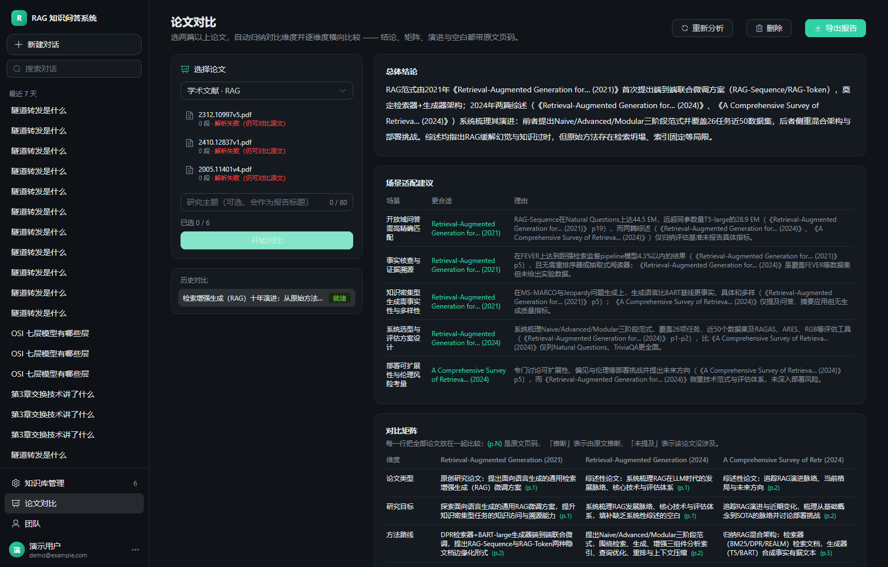
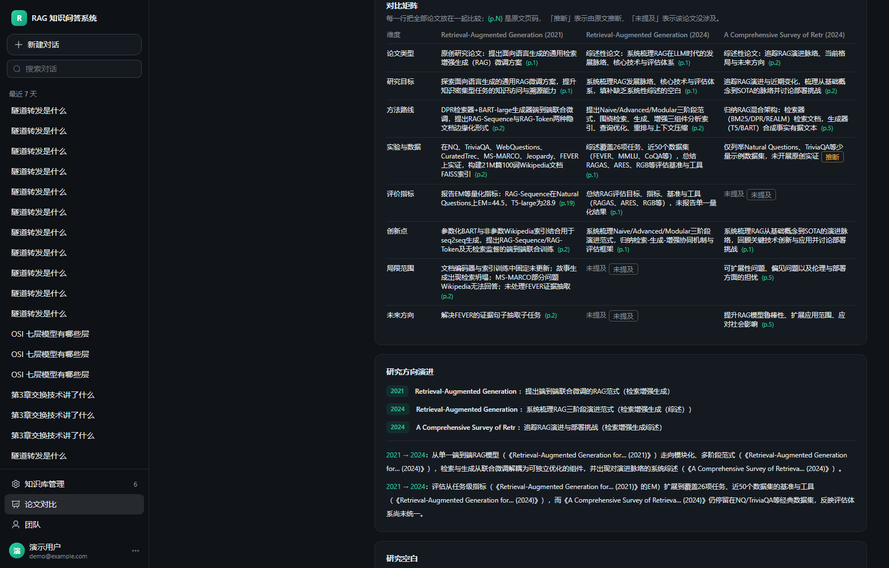

# 多篇论文智能对比

> 面向学术文献助手的核心能力：同时分析多篇论文，做**真正的横向比较**，
> 而不是各篇总结的拼接。

## 一、为什么难

需求里最关键的一句是「不能简单地把几篇论文分别总结后放在一起」。这句话决定了架构：

- 把 N 篇全文一次性丢给模型 → 超上下文（5 篇论文轻松 30 万字符），而且模型会退化成流水账；
- 分别总结再拼接 → 得到的是 N 段独立摘要，维度不对齐，无法回答「哪种方法在什么场景更好」。

所以必须**先结构化、再对齐**，拆成两个阶段。

## 二、两阶段流程

```
             ┌──────────── 阶段 A（每篇一次调用，可缓存）────────────┐
  论文 PDF → │ 结构化卡片：研究问题 / 方法族 / 关键技术 / 数据集 /     │
             │ 指标+数值 / 主要结果 / 创新点 / 局限 / 未来工作（带页码）│
             └──────────────────────────────────────────────────┘
                                    ↓  卡片压缩（每篇 ≤ 2200 字符）
             ┌──────────── 阶段 B（跨篇，4 次调用）──────────────────┐
             │ ① 自动归纳对比维度（不是写死的字段）                   │
             │ ② 逐维度填矩阵：每格 = 该论文的做法 + 页码 + 置信度     │
             │ ③ 演进时间轴 + 研究空白（可追溯到具体论文的局限）       │
             │ ④ 场景胜负结论（带指标数字）                          │
             └──────────────────────────────────────────────────┘
```

| 阶段 | 调用次数 | 说明 |
| --- | --- | --- |
| A 卡片抽取 | N（每篇 1 次） | 结果落 `paper_profiles`，同一篇论文重复对比不重复付费 |
| B1 维度归纳 | 1 | 由模型根据卡片差异提出，通常 6~8 个 |
| B2 矩阵填充 | 1 | 要求每行覆盖全部论文，缺的补 `missing` |
| B3 演进 + 空白 | 1 | 时间轴覆盖全部论文；空白须能追溯到 limitations / future_work |
| B4 场景结论 | 1 | 3~5 个场景，各自说明「谁更合适 + 为什么（带数字）」 |

整体：3 篇论文约 7 次模型调用；5 篇约 9 次。

## 三、取样策略（不读全文也不漏关键）

每篇论文只取约 28k 字符，但按**优先级抽样**而不是简单截断：

| 优先级 | 取哪些页 | 理由 |
| --- | --- | --- |
| 1 | 首 2 页 | 标题、摘要、引言 —— 研究问题与方法概述 |
| 2 | 末 2 页 | 结论、局限、future work —— 研究空白的来源 |
| 3 | 中段含 `experiment` / `results` / `dataset` 的页（最多 4 页） | 实验设置与指标 —— 矩阵里最有价值的格子 |

取出来的片段带 `[[PAGE n]]` 标记，模型据此给页码。

## 四、防幻觉的四道闸

| 手段 | 说明 |
| --- | --- |
| 页标记 + 页码校验 | 落库前检查页码是否落在该论文实际页数内，越界直接丢弃 |
| 置信度标注 | 每格 `explicit`（原文明确）/ `inferred`（推断）/ `missing`（未提及），前端淡色区分 |
| 漏格补齐 | 模型漏掉的论文补成 `missing`，保证矩阵不缺列 |
| id 可读化 | 正文里的 `doc_xxx` 替换成《短标题(年份)》，并处理「id + 年份」连写导致的年份重复 |

## 五、数据模型

```sql
paper_profiles                     -- 一篇论文一张卡片（按 document_id 唯一）
  document_id, knowledge_base_id, title, authors, year, venue,
  research_problem, method_family, key_technique, dataset, main_results,
  metrics_json, innovations_json, limitations_json, future_work_json,
  citations_json, page_count, status, extractor_version

comparisons                        -- 一次对比任务与全部产物
  user_id, team_id, topic, document_ids_json,
  status(pending/running/ready/failed), stage(cards/dimensions/matrix/trends/verdict/done),
  progress, dimensions_json, matrix_json, trends_json, gaps_json,
  verdict, scenarios_json, report_md, error
```

`report_md` 由结构化结果**拼装**（不是模型直接写），保证报告与界面显示一致；
重新打开对比不再调用模型。

## 六、接口

| 方法 | 路径 | 说明 |
| --- | --- | --- |
| POST | `/api/comparisons` | 创建（2~6 篇），后台执行，立即返回 `pending` |
| GET | `/api/comparisons` | 我的对比列表 |
| GET | `/api/comparisons/{id}` | 详情 + 进度（前端每 3 秒轮询） |
| POST | `/api/comparisons/{id}/rerun` | 重跑（卡片命中缓存，通常 20 秒内） |
| DELETE | `/api/comparisons/{id}` | 删除 |
| GET | `/api/comparisons/{id}/report.md` | 导出 Markdown 报告 |
| GET | `/api/papers/{documentId}` | 查看某篇的结构化卡片 |
| POST | `/api/papers/{documentId}/refresh` | 强制重抽卡片 |

请求体：

```json
{ "documentIds": ["doc_a", "doc_b", "doc_c"], "topic": "检索增强生成的演进" }
```

## 七、界面





单页长滚动：总体结论 → 场景适配建议 → 对比矩阵 → 研究方向演进 → 研究空白。
左侧是选论文（按知识库筛选、最多 6 篇）与历史对比列表。

## 八、实测数据

用三篇真实 arXiv 论文（RAG 原论文 + 2023 综述 + 2024 综述）：

| 指标 | 结果 |
| --- | --- |
| 自动归纳维度 | 7~8 个 |
| 矩阵覆盖 | 每行 3/3 篇，无缺列 |
| 带页码单元格 | 有（`(p.N)` 标注） |
| 研究空白 | 5 条，均带出处 |
| 场景结论 | 5 条，均带指标数字 |
| 首次耗时 | 约 60 秒（含 3 次卡片抽取） |
| 再次耗时 | 约 20 秒（卡片命中缓存） |

验收脚本：`server/tests/verify_compare.py`（28 项，全部通过）。

## 九、已知限制

1. **扫描版 PDF 无法抽取**（没有文本层），会明确报「未能解析出可用文本」；
2. 对比**不依赖向量库**（只读原文），因此 Chroma 不可用时仍可使用，
   但也意味着它不会引用检索序号，只引用页码；
3. 一次最多 6 篇：再多时提示词变长、费用上升、模型容易顾此失彼；
4. 对比结果目前**仅创建者可见**（团队共享留到下一迭代）。
