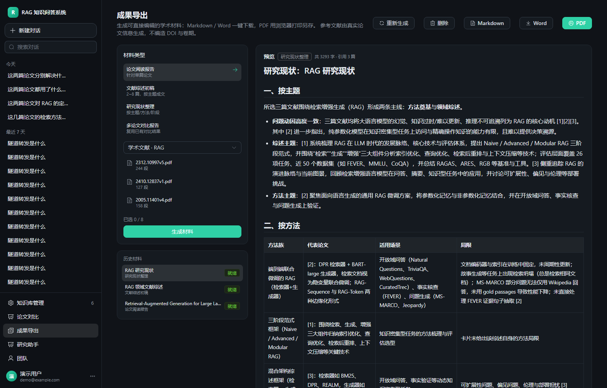
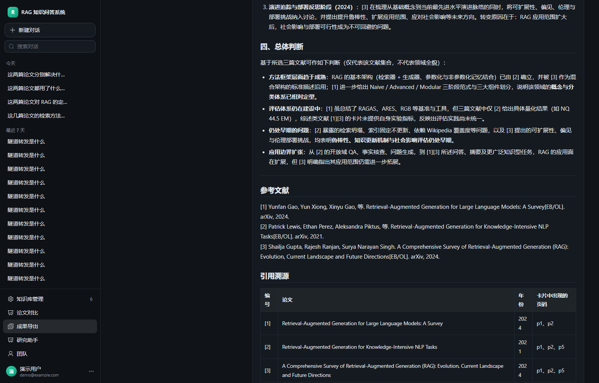

# 学术成果生成与导出

> 把系统的分析结果变成「能直接用、能继续编辑」的材料：Markdown / Word / PDF。

## 一、四类材料

| 类型 | 输入 | 产物 |
| --- | --- | --- |
| 论文阅读报告 | 1 篇 | 基本信息 / 研究问题 / 方法 / 实验与结果 / 创新点 / 局限 / 预留笔记位 |
| 文献综述初稿 | 2~8 篇 | 引言 / 研究脉络 / 主题分组 / 方法对比表 / 研究空白 / 结论 |
| 研究现状整理 | 2~8 篇 | 按主题 / 按方法（表）/ 按发展阶段 / 总体判断 |
| 多论文对比报告 | 1 条已有对比 | 直接复用对比结果，不重新生成 |

## 二、三种导出格式

| 格式 | 实现 | 说明 |
| --- | --- | --- |
| Markdown | 原样输出 | 内容源就是 Markdown |
| **Word (.docx)** | `python-docx` 转换 | **真文件**：标题层级、列表、表格、引用块都会还原 |
| PDF | 打印视图 + 浏览器「另存为 PDF」 | 见下 |

### 为什么 PDF 走浏览器打印

当前环境里没有可用的 PDF 生成库（reportlab / weasyprint / fpdf 都没装），
而**手写 PDF 生成器无法可靠嵌入中文字体**，导出的中文会变成方块。

所以 PDF 采用业界常见做法：后端给一份**打印专用 HTML**（A4 页边距、衬线中文字体、
表格边框、`@media print` 适配），前端打开后调起浏览器打印，用户选「另存为 PDF」。

- 优点：中文排版稳定、零额外依赖、离线可用
- 缺点：多一步「另存为」的系统对话框

> 接入 `weasyprint` 或 `reportlab` 后可改为服务端直出 PDF，
> 但需要额外装库并解决中文字体内嵌，属于独立的一轮工作。

## 三、不伪造的措施（核心要求）

需求写得很明确：**不能伪造文献、DOI、实验结果和参考文献**。

| 风险 | 我们的做法 |
| --- | --- |
| 编造参考文献 | 参考文献**只从论文卡片生成**（题名/作者/年份/来源都来自解析结果），缺字段就留空或写「出版年缺失」 |
| 编造 DOI / 卷期 | **完全不输出 DOI 与卷期**，报告末尾明确写「未提供 DOI 与卷期信息」 |
| 编造实验数据 | 提示词硬性禁止；卡片里没有的数字不写，报告里会出现「原文未提供量化结果」 |
| 引用对不上 | 报告末尾由系统生成「引用溯源」表（编号 / 论文 / 年份 / 页码），**不由模型生成** |
| 引用不存在的论文 | `sources_json` 只记录本次所选的论文，导出时据此生成参考文献，不会多出一篇 |

验收脚本里有专门的检查：

```python
# 内容里不能出现 doi: 或 10.xxxx/ 这类伪造标识
fabricated = re.findall(r'(?i)\bdoi\s*[:：]|10\.\d{4,9}/', text)
```

## 四、参考文献三种格式

| 格式 | 示例（本项目实际输出） |
| --- | --- |
| GB/T 7714 | `[1] Yunfan Gao, Yun Xiong, Xinyu Gao, 等. Retrieval-Augmented Generation for Large Language Models: A Survey[EB/OL]. arXiv, 2024.` |
| APA | `Yunfan Gao, Yun Xiong, Xinyu Gao (2024). Retrieval-Augmented Generation for Large Language Models: A Survey. arXiv.` |
| IEEE | `[1] Yunfan Gao, Yun Xiong, Xinyu Gao, "Retrieval-Augmented Generation for Large Language Models: A Survey", arXiv, 2024.` |

文献类型标记按来源保守判断：`arXiv`/`preprint` → `[EB/OL]`，
含 `conference`/`proceedings`/`workshop` → `[C]`，其余 `[J]`。

## 五、接口

| 方法 | 路径 | 说明 |
| --- | --- | --- |
| POST | `/api/reports` | 创建（kind + documentIds / comparisonId） |
| GET | `/api/reports` | 我的材料列表 |
| GET | `/api/reports/{id}` | 详情（含内容与三种格式的参考文献） |
| POST | `/api/reports/{id}/rerun` | 重新生成 |
| DELETE | `/api/reports/{id}` | 删除 |
| GET | `/api/reports/{id}/export?format=md\|docx\|html` | 导出 |

## 六、界面





左侧选材料类型与论文；右侧预览渲染后的 Markdown，底部可切换
GB/T 7714 / APA / IEEE 三种参考文献格式。
顶部四个按钮：重新生成、删除、Markdown、Word、PDF。

## 七、验证

```powershell
cd server
.\.venv\Scripts\python.exe tests\verify_reports.py
```

**33 项全部通过**：

```
参数：非法 kind / 阅读报告选多篇 / 对比缺 id → 400；他人论文 → 404
生成：reading 1571 字、review 4573 字、status 3998 字
溯源：三份报告的 sources 与所选论文一一对应，且带编号与页码
格式：GB/T 7714 / APA / IEEE 各 3 条
不伪造：三份报告均无 doi/10.xxxx，均含「引用溯源」一节
导出：md / html / docx（PK 头，可被 python-docx 打开且有参考文献段落）
权限：他人不可读、不可导出
```

## 八、已知限制

1. PDF 依赖浏览器「另存为 PDF」，不是服务端直出；
2. DOCX 的样式是通用模板（标题/正文/表格），未做学校论文模板；
3. 综述初稿的参考文献只覆盖**所选论文**，不会自动补全领域内其它文献
   —— 这是刻意的：宁可少，不编造。
