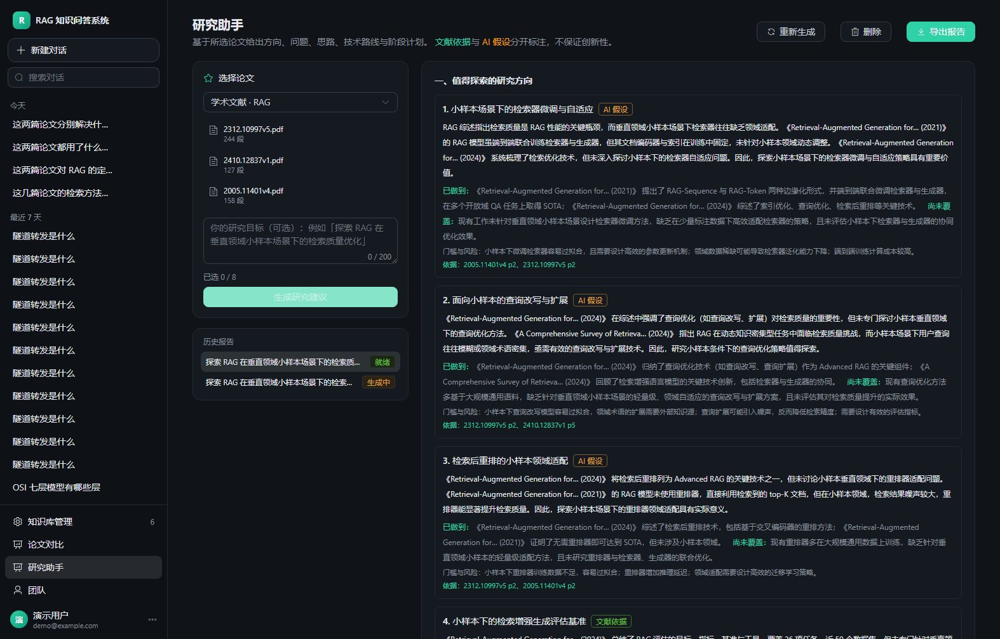
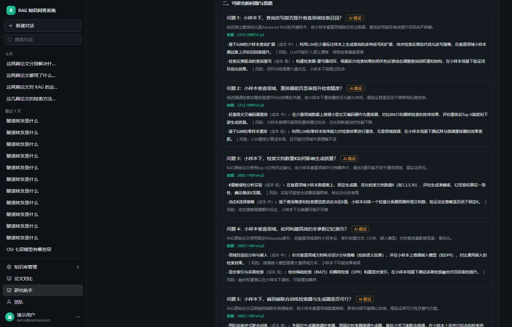
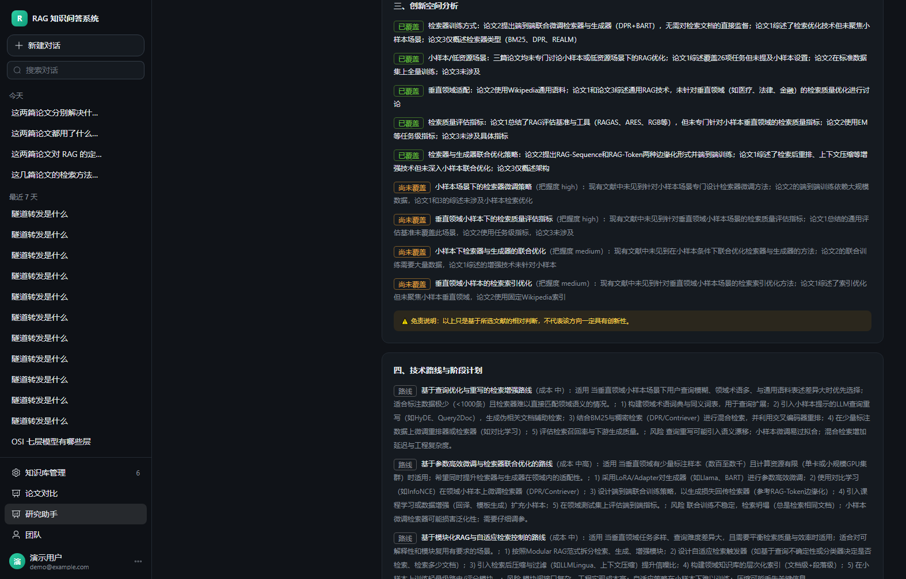

# 学术研究辅助

> 从「读懂已有论文」往前一步：基于所选文献，给出研究方向、研究问题、思路、技术路线与阶段计划。

## 一、核心约束（决定了整个设计）

需求里最关键的一句：

> 所有研究建议都应该以已有文献证据为基础，并明确区分已有研究结论与 AI 提出的假设或建议，
> 不能保证某个方向一定具有创新性。

这句话直接落成**数据结构上的强制字段**，而不是靠提示词「请注意区分」：

| 字段 | 取值 | 含义 |
| --- | --- | --- |
| `kind` | `evidence` | 已有文献明确写了 —— 必须带 `evidence`（documentId + 页码） |
|  | `hypothesis` | AI 推测的研究假设，**没有**文献直接支撑 |
|  | `suggestion` | AI 给出的可执行建议（路线、计划、检索方向） |

并且有两道**强制降级**：

1. `kind=evidence` 但 `evidence` 为空 → 自动降级为 `hypothesis`，并加一句
   「原文未能确认，已降级为推测」。宁可标成推测，也不能把没依据的话伪装成文献结论。
2. 创新空间（`novelty.openings`）**无论模型返回什么，一律标成 `hypothesis`**，
   并附固定免责说明：「以上判断只基于所选文献，不代表这些方向一定具有创新性。」

## 二、生成流程

```
A. 论文卡片（复用 compare.extract_card，按 documentId 缓存，不重复花钱）
B. 研究方向      —— 3~5 个，每个带：为什么值得做 / 已做到什么 / 还缺什么 / 风险
C. 研究问题 + 思路 —— 3~6 个问题，每个配 1~2 条 approach（含成本与风险）
D. 技术路线 + 阶段计划 —— 3~4 条路线；3~5 个阶段（目标/任务/产出/风险）
E. 创新空间分析  —— 覆盖了什么 / 尚未覆盖什么（相对表述，不给"一定创新"）
F. 相关工作梳理  —— 按主题分组 + 「建议去检索什么」（检索建议≠文献引用）
G. 本地相关文献  —— 库里按标题相似度推荐（明确标注"未经相关性验证"）
H. 拼装 Markdown 报告
```

整体 6 次模型调用 + N 次卡片抽取（有缓存时 0 次），实测 3 篇论文约 50 秒。

## 三、数据模型

`research_briefs`：一次研究任务的输入与全部产物。

```
id / user_id / team_id / goal / document_ids_json
status(pending/running/ready/failed) / stage / progress / error
directions_json  questions_json  roadmap_json  novelty_json
related_work_json  related_docs_json  report_md
```

## 四、接口

| 方法 | 路径 | 说明 |
| --- | --- | --- |
| POST | `/api/research/briefs` | 创建（1~8 篇 + 可选研究目标），后台执行 |
| GET | `/api/research/briefs` | 我的报告列表 |
| GET | `/api/research/briefs/{id}` | 详情 + 进度（前端 3 秒轮询） |
| POST | `/api/research/briefs/{id}/rerun` | 重新生成（卡片命中缓存） |
| DELETE | `/api/research/briefs/{id}` | 删除 |
| GET | `/api/research/briefs/{id}/report.md` | 导出 Markdown |

## 五、界面







左侧选论文（按知识库筛选、最多 8 篇）+ 填研究目标；右侧分六节展示：

1. 值得探索的研究方向（每条带 `文献依据` / `AI 假设` 标签与出处）
2. 可研究的问题与研究思路（含成本、风险）
3. 创新空间分析（已覆盖 / 尚未覆盖，附免责说明）
4. 技术路线与阶段计划（表格）
5. 相关工作梳理 + 建议补充检索的方向
6. 库里可能相关的其它文献（标注未经验证）

## 六、验证

接口契约（不需要向量库）：

```powershell
cd server
.\.venv\Scripts\python.exe tests\verify_research.py
```

实测一次（3 篇 RAG 论文，目标「探索 RAG 在垂直领域小样本场景下的检索质量优化」）：

| 项 | 结果 |
| --- | --- |
| 方向 | 5 个 |
| 研究问题 | 6 个（每个 2 条思路） |
| 创新空间 | 已覆盖 5 条 / 尚未覆盖 4 条 |
| 相关工作 | 3 组 + 5 条补充检索建议 |
| 本地推荐文献 | 6 篇 |
| 耗时 | 48 秒（卡片已缓存） |
| 报告 | 11k 字符 |

## 七、已知限制

1. **不联网检索文献**：「相关文献补充」目前只做「库里其它文档的推荐」+
   「告诉你该用什么关键词去查」，没有接 arXiv/Semantic Scholar。
   好处是不会编造不存在的论文；坏处是补充文献需要用户自己动手。
2. 创新性判断本质上是**基于所选文献的相对判断**，文献选得少时偏差会很大，
   界面上已经固定展示免责说明。
3. 研究计划是**建议模板**，不含真实排期与人力估算。
4. 一次最多 8 篇：再多时模型会顾此失彼。
